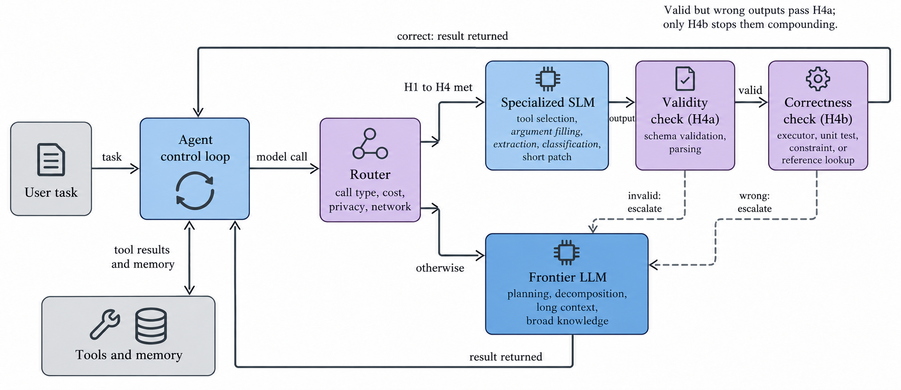

# Less is More

### A Survey of Small Language Models for Agentic AI: Architectures, Compression, Deployment, and Evaluation

Research materials for the ACM Computing Surveys submission by **Mohammed Gamal Ragab** and **Amgad Muneer**: the manuscript, electronic supplement, model inventory, source-verification records, and scripts for generating the inventory tables and plots.

**[Manuscript](ACM-Journals/less-is-more.tex)** · **[Supplement](ACM-Journals/supplement.tex)** · **[Released artifacts](release/README.md)** · **[Model inventory](release/merged_llm_database.json)** · **[Evaluation coverage ledger](release/audit_coverage_ledger.csv)**

## The research question

When should a small language model be the default model inside an AI agent?

This structured narrative survey examines architectures, training and compression, deployment constraints, evaluation reporting, and collaboration between small and large models. Its central hypothesis is conditional: a specialized SLM should handle a recurring call type when the task is bounded, its input is short, its outputs can be checked for validity **and correctness**, and its volume clears the break-even point after accounting for specialization, retries, checks, and escalation.

The paper separates evidence for individual model calls from evidence for complete agent tasks, and proposes a comparison that could refute the hypothesis for a workload. It does not report a new benchmark run or establish an end-to-end cost advantage for SLM-first agents.

<p align="center">
  
</p>

## What is included

- **A two-bound definition of small.** Active parameters per token describe the compute envelope; total parameters describe the storage envelope.
- **A versioned model inventory.** Records include model characteristics, classification decisions, release-date precision, and developer-source checks.
- **An evaluation-reporting audit.** A coverage ledger records which instruction-tuned results vendors report and under which stated protocols.
- **A conditional agent design hypothesis.** The paper states qualifying workloads, failure cases, break-even economics, and a proposed falsification design.
- **Reproducibility materials.** Python scripts generate inventory tables, data plots, inclusion decisions, and the audit ledger. Provenance records accompany the conceptual diagrams.

## Inventory at a glance

The checked-in **version 3.6** snapshot covers releases through **4 September 2026**, with developer-source checks dated **8 October 2026**. Counts refer to separately released model variants; multiple variants can belong to one family.

| Class | Rule | Variants | JSON location |
|---|---|---:|---|
| SLM | Active and total parameter counts each at most approximately 20B | 179 | `models.slm`, filtered by `slm_class == "slm"` |
| Small-active-parameter MoE | Active count at most approximately 20B; total count exceeds the bound | 30 | `models.slm`, filtered by `slm_class == "small-active-moe"` |
| Disclosed-size comparison model | Fails the active-parameter condition | 104 | `models.llm`, filtered by `slm_class == "llm"` |
| Undisclosed-size comparison model | Published counts are insufficient for classification | 119 | `models.llm`, filtered by `slm_class == "undisclosed"` |
| Excluded record | Removed under the documented inclusion criteria | 7 | `models.excluded` |

The `models.slm` array contains **209 records across two classes**. Filter on `slm_class` when counting SLMs. Small-active-parameter MoEs are treated separately in storage and on-device claims; undisclosed values are not imputed.

The evaluation audit covers **14 cohort models × 8 benchmarks = 112 cells**. Of those cells, **69** contain a reported instruction-tuned value. No benchmark is reported for all 14 models, and the largest group sharing one stated protocol on a benchmark contains five models. The ledger describes reporting coverage, rather than a comparable performance ranking.

## Repository map

| Path | Purpose |
|---|---|
| [`ACM-Journals/`](ACM-Journals/) | Active ACM manuscript and supplement, bibliography, section sources, figures, and generated LaTeX partials |
| [`ACM-Journals/figures/`](ACM-Journals/figures/README.md) | Publication figures; [AI figure provenance](ACM-Journals/figures/AI-FIGURES.md) records generation and corrections |
| [`source/`](source/) | Development inventory, verification logs, Python environment, and data-maintenance scripts |
| [`release/`](release/README.md) | Self-contained data and script snapshot accompanying the submission |

Use `source/` for ongoing work and `release/` for the submission snapshot. Each has its own `pyproject.toml` and `uv.lock`. The active manuscript is in `ACM-Journals/`.

## Reproduce the data artifacts

### Set up Python

Requirements: **Python 3.14 or later** and **uv**. Run these commands from the repository root:

```sh
cd source
uv sync --locked
```

The locked environment includes pandas, Plotly, and Kaleido. Static plot export also needs Chrome or Chromium available to Kaleido. Install **Libertinus Serif as a system font** to match the manuscript typography; the LaTeX font package alone does not make it available to the plot renderer.

### Generate tables and the evaluation ledger

From `source/`:

```sh
uv run python scripts/generate_model_tables.py --input merged_llm_database.json --output-dir ../ACM-Journals/partials
uv run python scripts/build_audit_ledger.py
```

The first command generates five model-landscape and chronological-inventory LaTeX partials. The second writes `source/audit_coverage_ledger.csv`, updates `ACM-Journals/partials/audit_coverage_ledger.tex`, and prints the reporting-coverage summary.

### Generate inventory plots

From `source/`:

```sh
uv run python scripts/generate_figures_v2.py --input merged_llm_database.json --output-dir ../ACM-Journals/figures --format png
```

This generates the `paper_*.png` data plots. The conceptual diagrams named `fig01` through `fig07` have separate [provenance](ACM-Journals/figures/AI-FIGURES.md); the plotting script does not recreate them. Existing conceptual figures are included in the repository.

To reproduce the release snapshot instead, use the environment and commands in [`release/README.md`](release/README.md).

### Refresh source checks or classification

The maintenance scripts below modify the development inventory. Run them from `source/` when deliberately updating the dataset:

```sh
uv run python scripts/verify_sources.py
uv run python scripts/apply_inclusion_rules.py
```

`verify_sources.py` queries the live Hugging Face Hub and updates the inventory and `source_check_log.csv`. Results can differ from the recorded October snapshot as repositories change. `apply_inclusion_rules.py` recomputes the classification fields, applies named editorial exclusions, rebuilds the model arrays, and appends a changelog entry. Historical record corrections are documented in `scripts/fix_records_v3_6.py`.

## Build the paper and supplement

Use a TeX distribution with **pdfLaTeX** and **BibTeX**, such as MiKTeX or TeX Live. The ACM class and bibliography style are included. The sources also require packages including `libertinus-type1`, `libertinust1math`, `glossaries`, `xr`, and TikZ, along with the table packages declared in the preambles.

The manuscript and supplement reference each other's `.aux` files. From the repository root, build the main paper, then the supplement, then the main paper again:

```sh
cd ACM-Journals
pdflatex -interaction=nonstopmode -halt-on-error less-is-more.tex
bibtex less-is-more
pdflatex -interaction=nonstopmode -halt-on-error less-is-more.tex
pdflatex -interaction=nonstopmode -halt-on-error less-is-more.tex

pdflatex -interaction=nonstopmode -halt-on-error supplement.tex
bibtex supplement
pdflatex -interaction=nonstopmode -halt-on-error supplement.tex
pdflatex -interaction=nonstopmode -halt-on-error supplement.tex

pdflatex -interaction=nonstopmode -halt-on-error less-is-more.tex
pdflatex -interaction=nonstopmode -halt-on-error less-is-more.tex
```

The outputs are `ACM-Journals/less-is-more.pdf` and `ACM-Journals/supplement.pdf`. PDFs are generated locally and are not included in the current source snapshot. Inventory regeneration is optional for a build: the manuscript's generated partials and required figure assets are already included.

Missing external-reference warnings are expected during the initial passes, before both `.aux` files exist. Check the final logs for unresolved citations and references. If cross-document labels change during editing, rerun the affected document and its counterpart until the references settle.

On Windows, [`ACM-Journals/build.bat`](ACM-Journals/build.bat) builds and opens the **main paper only**. Use the full sequence above when building both documents from a fresh checkout.

## Working with the materials

Edit manuscript text in `ACM-Journals/sections/` and references in `ACM-Journals/bibliography.bib`. For inventory changes, update the development data and scripts, regenerate affected artifacts, and reconcile the counts with the manuscript before refreshing the release snapshot. Edit data generators rather than their generated LaTeX tables or plots.

The survey is a **structured narrative review**. Its model inventory and literature coverage have the limits described in the [method section](ACM-Journals/sections/supp_method.tex). Benchmark values originate in cited reports and can use different protocols. Source verification establishes the recorded developer source; it does not independently validate every vendor claim.

## Citation

The repository contains a submission manuscript with no assigned DOI. Until publication details are available, cite the manuscript as unpublished:

```bibtex
@unpublished{ragab2026slm_agentic_survey,
  author = {Ragab, Mohammed Gamal and Muneer, Amgad},
  title  = {A Survey of Small Language Models for Agentic AI:
            Architectures, Compression, Deployment, and Evaluation},
  year   = {2026},
  note   = {Manuscript, ACM Computing Surveys submission version}
}
```

For inventory-based analyses, also identify **inventory version 3.6**, the release cutoff, and the repository commit used.

## Contact and reuse

Corresponding author: **Mohammed Gamal Ragab**, Universiti Teknologi PETRONAS — [mohammed.ragab@utp.edu.my](mailto:mohammed.ragab@utp.edu.my).

No repository-wide license is currently included. Contact the authors about reuse permissions; bundled third-party files retain their own license notices.
